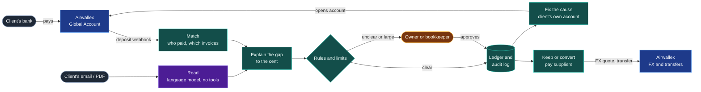

  

  
  
  
  

<h3 align="center">€930 arrives. €1,000 was invoiced. The reference says "MARCH".</h3>

Someone now has to work out who paid, for which invoices, and where €70 went. Every month. By hand. Receive to Reconciled does it, and then makes sure it doesn't happen again.

---

## Where did €70 go?

Small businesses paid from abroad get less than they invoiced, from a name they don't recognise, with a reference that says nothing. One accountant writes: *"This happens on maybe 60% of our international wires. Amount received never matches amount sent"* ([r/Accounting, Feb 2026](https://www.reddit.com/r/Accounting/comments/1rdaid8/how_do_you_get_paid_in_full_on_international_wire/)). Accounting software handles the clean cases. Xero is still *"tackling more complex use cases, like scenarios where a single payment covers multiple invoices"* ([Xero, Aug 2026](https://blog.xero.com/?p=40102)). The rest is left to a person. → [The full problem](docs/01-problem.md)

## Not just matched. Fixed.

Most tools stop at matching. Receive to Reconciled goes one step further: it removes the reason a payment was short.

| | What the agent does | Who decides |
|:-:|---|---|
| **1** | **Notices** each payment the moment Airwallex receives it | Code |
| **2** | **Identifies** who paid and which invoices it covers, including one payment for many invoices and payments in parts | Code |
| **3** | **Explains** the gap to the cent, reading the client's email or PDF for evidence | A model reads the text; code checks every number |
| **4** | **Records it, or asks.** It never forces a match, and never chases a client whose money is already waiting. | Code, or a person when unclear |
| **5** | **Fixes the cause.** For a client who keeps paying short, it opens a local Airwallex account for them and prepares everything their accounts team needs to accept the change. | A person approves every message |
| **6** | **Decides where the money sits.** It keeps currency needed for bills in that currency and converts only the real gap. | Code; the owner approves above a limit |

→ [The solution, with an example week](docs/02-solution.md)

## What already exists, and what it leaves

| | Accounting software | Airwallex today | **Receive to Reconciled** |
|---|:-:|:-:|:-:|
| Matches payments that arrive in full | ✓ | ✓ per-customer accounts ([docs](https://www.airwallex.com/docs/payments/payment-methods/global/bank-transfer/dedicated-account-per-customer)) | ✓ |
| Short payments, part payments, one payment for many invoices | partly | a short transfer leaves the payment "pending" | **✓** |
| Explains *why* money is missing: fee, credit, discount, tax | — | — | **✓** |
| Chooses which clients to move to their own account, and sees the switch through | — | — | **✓** |
| Decides whether to keep or convert, from what has really arrived | — | — | **✓** |
| India: links each export receipt to its record at the bank | — | — | **✓** ([India module](docs/india-module.md)) |

"—" means we found no such feature documented in the products and entries we reviewed, not proof that none exists.

We build on Airwallex rather than around it. Airwallex is also adding accounting-side reconciliation through Leapfin ([IT Brief Australia, Jun 2026](https://itbrief.com.au/story/airwallex-buys-leapfin-to-add-accounting-automation)). We work earlier, where the money arrives. → [Airwallex integration](docs/04-airwallex-integration.md)

## The seven problems we solve first

Chosen from the **[56 problems we mapped](docs/05-pain-atlas.md)** because they survived a skeptic's review, aren't solved today, and can be fixed with Airwallex's APIs.

| | Problem | The agent's answer |
|---|---|---|
| `A01` | Banks along the way take fees, so wires arrive short | Explains the fee from the gap; moves repeat payers to local transfers |
| `A10` | A payment can't be matched halfway | Records what it's sure of and parks the rest |
| `A13` | One invoice paid in several parts | Keeps a running balance per invoice |
| `A26` | Payments matched to the wrong client | Matches only when account, reference and amount all agree |
| `A28` | Bank feeds cut off the reference | Reads the full details straight from Airwallex |
| `A38` | Clients are slow to accept new bank details | Prepares the bank-change pack and confirms the first payment |
| `A47` | Indian export records stay open after payment | Links each receipt to its record and drafts the note to the bank |

## Built on evidence

Every item has a word-for-word quote, a link and a date, and every number above is counted from these files:

[`ideas-compared.csv`](research/data/ideas-compared.csv) · [`repos-reviewed.csv`](research/data/repos-reviewed.csv) · [`evidence-test-ledger.csv`](research/data/evidence-test-ledger.csv) · [`pain-map-items.csv`](research/data/pain-map-items.csv) · [`pains.csv`](research/data/pains.csv) · [`hypotheses.csv`](research/data/hypotheses.csv)

Run `python scripts/check_numbers.py` to recount every figure in the [numbers register](research/numbers.md). How we gathered, checked and scored it, and where it falls short: [research method](docs/08-research-method.md) · [all 61 sources](research/citations.md).

## How it's built

Rules in code make every decision about money. A language model only reads messy text, and what it reads is checked against the numbers. Nothing written in a document can move money. → [Architecture, with five diagrams](docs/03-architecture.md)

## Three weeks, three layers

The day-by-day plan, with what each of us owns and when each step counts as done: → [Build plan](docs/06-build-plan.md)

## Explore

| | |
|---|---|
| **Understand it** | [Problem](docs/01-problem.md) · [Solution](docs/02-solution.md) · [Glossary of 110 terms](docs/09-glossary.md) |
| **See how it works** | [Architecture](docs/03-architecture.md) · [Airwallex integration](docs/04-airwallex-integration.md) · [India module](docs/india-module.md) |
| **Check our homework** | [Pain atlas](docs/05-pain-atlas.md) · [Research method](docs/08-research-method.md) · [Citations](research/citations.md) · [Numbers register](research/numbers.md) · [Raw records](research/data/) |
| **Follow the plan** | [Build plan](docs/06-build-plan.md) · [Risks](docs/07-risks.md) · [Decision log](docs/10-decision-log.md) |
| **Run something** | [Scripts](scripts/): recount every number, check the Airwallex sandbox, regenerate these visuals |

## Team

| | |
|---|---|
| **Rishi** · Mumbai | AI / LLM System Engineer |
| **Vedant** · Mumbai | AI Agent Developer |

Built for the <a href="https://airwallex.hackerearth.com/">Airwallex Agentic Banking Hackathon</a> · Treasury &amp; Ops · 2026 · The visuals in <code>assets/</code> are generated by <code>scripts/build_visuals.py</code> from the research records, so their numbers can't drift.

