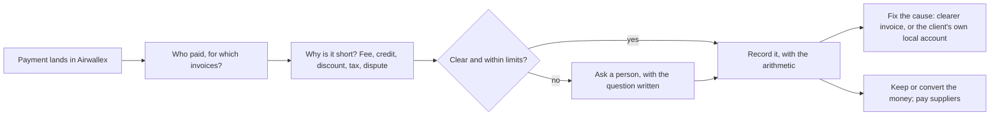

# Receive to Reconciled

**An agent that explains and fixes short cross-border payments.**

Small businesses paid by customers abroad often receive less than they invoiced, from a name they don't recognise, with a reference that says nothing. Receive to Reconciled works out which invoices each payment covers and why money is missing. Then it fixes the reason, so the same client doesn't cause the same problem next month, and it decides whether to keep the money in that currency or convert it for the bills that are due. It runs on Airwallex.

> **Status: design stage.** This repository holds our research and our design for the [Airwallex Agentic Banking Hackathon](https://airwallex.hackerearth.com/) (Treasury & Ops). The build starts on 25 October 2026. No product code is here yet.

## The problem, in one payment *(a made-up example)*

A design agency in Mumbai, trading through a company in Singapore with an Airwallex account, invoices a German client €600 and €400. One payment arrives:

> **€930** · from "ACME HOLDING BV" · reference "MARCH"

- **Who paid?** The client's parent company, not the company on the invoice.
- **For which invoices?** The reference doesn't say.
- **Why €70 short?** A €50 credit for a late delivery, plus €20 kept by a bank on the way. The only explanation is an email in someone's inbox.

Today someone works this out by hand, writes the gap off, and sometimes chases a client who has already paid. Then it happens again next month. This isn't rare. One accountant writes: "This happens on maybe 60% of our international wires" ([r/Accounting, Feb 2026](https://www.reddit.com/r/Accounting/comments/1rdaid8/how_do_you_get_paid_in_full_on_international_wire/)). → [The full problem](docs/01-problem.md)

## What the agent does

1. **Notices** each payment the moment Airwallex receives it.
2. **Works out** who paid and which invoices it covers, even when one payment covers several invoices or arrives in parts.
3. **Explains the gap to the cent**, for example €1,000 − €50 credit − €20 bank fee = €930, and reads the client's email or PDF for evidence.
4. **Records it, or asks a person.** It never forces a match, and it never sends a reminder while unexplained money from that client is waiting.
5. **Fixes the cause.** For a client who keeps paying short by international wire, it opens a local Airwallex account for them and prepares everything their accounts team needs to accept the change.
6. **Decides where money sits.** It keeps currency that's needed for bills in that currency, converts only the real gap, and pays the supplier, with the owner's approval above a limit.

Rules in code make every decision about money. A language model is used only to read messy text, and what it reads is always checked against the numbers. → [The solution](docs/02-solution.md) · [Architecture](docs/03-architecture.md)

## Built on research, with every number on the record

| What we did | Size | Record |
|---|---|---|
| Ideas compared before choosing this one | 35 | [ideas-compared.csv](research/data/ideas-compared.csv) |
| Public repositories read, to see what others are building | 57 (44 hackathon entries) | [repos-reviewed.csv](research/data/repos-reviewed.csv) |
| Sourced items testing our two finalist ideas | 476, of which 385 were re-opened and confirmed | [evidence-test-ledger.csv](research/data/evidence-test-ledger.csv) |
| Sourced items mapping the day-to-day problems | 429 | [pain-map-items.csv](research/data/pain-map-items.csv) |
| Distinct problems found and scored | 56, of which we build for 7 first | [pains.csv](research/data/pains.csv) · [the pain atlas](docs/05-pain-atlas.md) |
| Questions tested in advance | 20 (9 confirmed, 11 weakened) | [hypotheses.csv](research/data/hypotheses.csv) |

Every item has a word-for-word quote, a link and a date. Every number above is in the [numbers register](research/numbers.md), and `python scripts/check_numbers.py` recounts each one from the files. → [How we researched this](docs/08-research-method.md)

## How it fits with Airwallex

Airwallex already lets a business give each customer its own account number, and matches payments that arrive in full ([docs](https://www.airwallex.com/docs/payments/payment-methods/global/bank-transfer/dedicated-account-per-customer)). It has also bought Leapfin for reconciliation at the accounting end ([IT Brief Australia, Jun 2026](https://itbrief.com.au/story/airwallex-buys-leapfin-to-add-accounting-automation)). We sit in between. We handle the payments that don't arrive in full, explain why, decide which clients are worth moving to their own account, and make sure the move happens. → [Airwallex integration](docs/04-airwallex-integration.md)

## Repository map

| Read this | For |
|---|---|
| [docs/01-problem.md](docs/01-problem.md) | The problem in plain words, with sources |
| [docs/02-solution.md](docs/02-solution.md) | What the agent does, the decisions inside the job, an example week, the seven problems we solve first |
| [docs/03-architecture.md](docs/03-architecture.md) | The parts, diagrams of how a payment flows, safety by design |
| [docs/04-airwallex-integration.md](docs/04-airwallex-integration.md) | Which Airwallex features we use, what they can't do, day-1 checks |
| [docs/05-pain-atlas.md](docs/05-pain-atlas.md) | All 56 problems, scored, by stage |
| [docs/06-build-plan.md](docs/06-build-plan.md) | The three-week build plan, day by day |
| [docs/07-risks.md](docs/07-risks.md) | The strongest case against us, and our answers |
| [docs/08-research-method.md](docs/08-research-method.md) | How the research was done, checked and scored, and its limits |
| [docs/09-glossary.md](docs/09-glossary.md) | Every finance and banking term, in plain words |
| [docs/10-decision-log.md](docs/10-decision-log.md) | Key decisions, with dates and reasons |
| [docs/india-module.md](docs/india-module.md) | India's export rules and what the module does |
| [research/citations.md](research/citations.md) | Every source we cite, what it says and how we use it |
| [research/numbers.md](research/numbers.md) | Every number we quote, and the file behind it |
| [research/data/](research/data/) | The full records as CSV files you can filter on GitHub |
| [scripts/](scripts/) | The number checker and the Airwallex sandbox check |

## Team

- **[YOUR NAME]**, Mumbai. [ROLE AND ONE LINE OF EXPERIENCE]
- **[FRIEND'S NAME]**, [CITY]. [ROLE AND ONE LINE OF EXPERIENCE]
