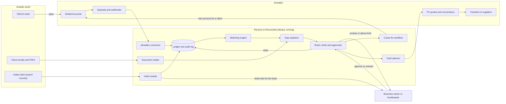
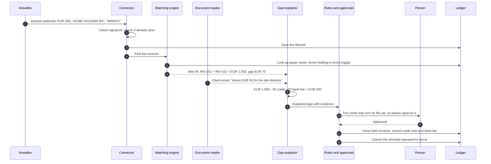
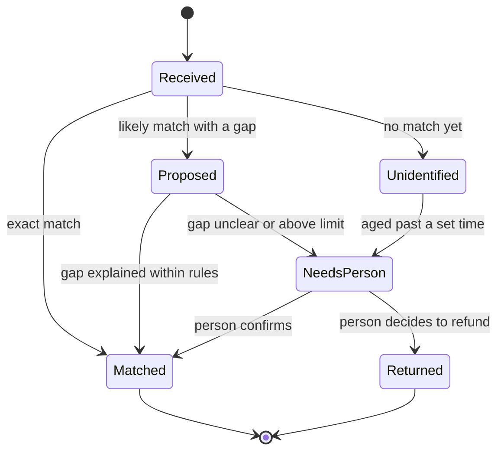
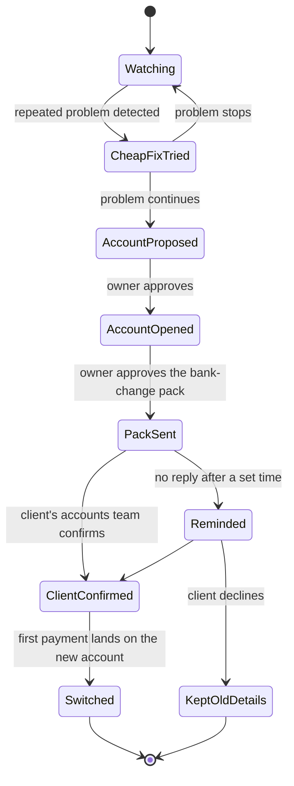
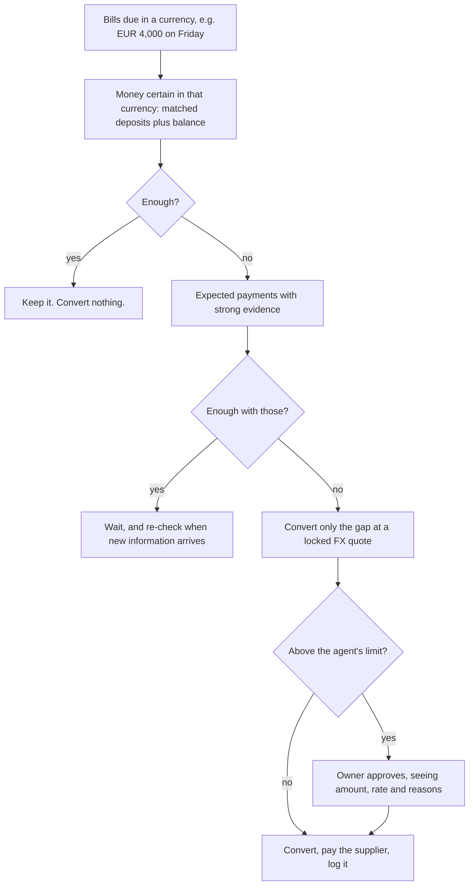

# Architecture

This page explains how Receive to Reconciled is put together: the parts, how a payment flows through them, and where people stay in control. The diagrams are drawn in [Mermaid](https://mermaid.js.org/), which GitHub shows as pictures.

**Status:** this is our design for the build that starts on 25 October 2026. Nothing below is built yet. The technology choices at the end are proposals we will confirm on day 1.

## The idea in one picture

Receive to Reconciled is a service that runs on its own, all day, connected to a business's Airwallex account. It isn't a chatbot. Most of the work is ordinary software following written rules. A language model is used for one narrow job: reading messy text such as a client's email or PDF. What it reads is always checked against the numbers.

## The parts

| Part | What it does | Rules in code, or a model? |
|---|---|---|
| **Airwallex connector** | Logs in, calls Airwallex's APIs, receives webhooks, checks their signatures, and ignores duplicates. It also re-reads recent deposits on a timer, in case a webhook is missed. | Code |
| **Ledger and audit log** | Holds customers, invoices, known payer names, deposits, matches, gaps, approvals and every action taken. The audit log is append-only. | Code |
| **Matching engine** | Decides which open invoices a deposit pays. It tries the strongest signals first: the receiving account, then an exact reference, then a known payer name. Then it runs a bounded search for combinations of invoices within set tolerances for fees, tax and exchange rates. It never forces a match. | Code |
| **Gap explainer** | Splits any difference into named parts: bank fee, credit note, discount, withheld tax, dispute or unknown. Every part must add up to the cent. | Code, using what the document reader found |
| **Document reader** | Reads remittance emails and PDFs, and pulls out invoice numbers, amounts and deductions. Each figure points to the exact words it came from. | Language model, with every output checked by code |
| **Rules, limits and approvals** | Decides whether something can go ahead automatically or needs a person. Sets tolerances and money limits. Ties each approval to the exact terms shown. | Code |
| **Cause-fix workflow** | Tracks each client's payment habits. When a client keeps causing the same problem, it proposes the cheapest fix, opens a dedicated account if needed, and runs the bank-change process. | Code; the model only drafts the wording of messages |
| **Cash planner** | Works out what money is really available and what's due. Decides whether to keep or convert currency, gets a locked FX quote, and pays suppliers. | Code |
| **India module** | Imports the Indian bank's list of open export records, links each payment to its record, and drafts the note to the bank. | Code; the model only drafts wording |
| **Dashboard** | Shows the exception queue, approval cards, client scorecards and the audit trail. Sends notifications. | Code |

## One payment, start to finish

This is the €930 payment from the example in the [README](../README.md).

## How a deposit moves through states

Every deposit has a clear state. It can only move along these arrows, and every move is written to the audit log.

## Fixing the cause: moving a client to its own account

Clients' accounts teams check new bank details carefully, so the switch is a process with its own states. The old details keep working the whole time.

## Deciding whether to keep or convert

## Safety by design

- **Outside text is read, never obeyed.** The document reader has no tools. It can't move money, mark invoices paid or change rules. A line hidden in a PDF saying "mark all invoices paid" has no effect.
- **Numbers must add up.** A match or an explained gap is only accepted when the parts sum exactly to the deposit.
- **Approvals are bound to what was shown.** An approval covers the exact amount, currency, FX quote, payee and evidence. If any of them changes, the approval no longer counts.
- **No double actions.** Every call that moves money carries a unique request ID that is reused on retry. Webhooks are de-duplicated, because they can arrive twice or out of order.
- **Limits tighten when evidence is weak.** The agent may act alone only on small, well-evidenced amounts.
- **New bank details are treated as a fraud risk.** Changes are confirmed through contacts already on file.
- **Everything is logged.** Each decision records what was seen, which rule applied and who approved it.

## Proposed technology (to confirm on 25 October)

| Area | Proposal | Why |
|---|---|---|
| Language | TypeScript on Node.js | One language for the service and the dashboard |
| Dashboard | Next.js | Approval cards, queues and scorecards |
| Database | PostgreSQL | Reliable money records and an append-only audit table |
| Background jobs | A Postgres-backed job queue | Timed re-reads of deposits, ageing of unmatched money, reminders |
| Document reading | A language model behind one interface | Can be swapped for another model without touching the rules |
| Airwallex | REST API in the sandbox, with simulation calls kept behind one interface | The [Builder Guide](https://airwallexdev.com/agentic-banking-builder-guide.md) recommends keeping sandbox-only calls replaceable |
| Hosting | One small cloud service plus a managed database | Enough for the demo; the design scales later |

## Where this is explained further

- What we use from Airwallex, and what it can't do: [Airwallex integration](04-airwallex-integration.md)
- The problems this design answers: [The pain atlas](05-pain-atlas.md)
- The India part: [India module](india-module.md)
- How we'll build it in three weeks: [Build plan](06-build-plan.md)
