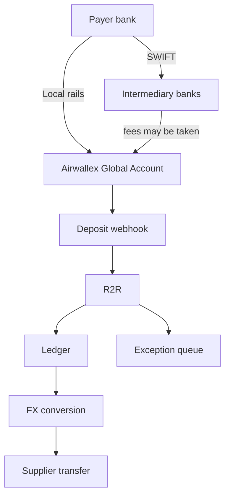

# 04 · Airwallex integration

Which Airwallex features R2R uses, what they can and cannot do, and what we test on day 1 in the sandbox (Airwallex's test environment: fake money, real APIs). Each claim links to the page we read. Where we could not confirm something, we say so.

## 1. Summary

| Capability | Airwallex feature / endpoint | What R2R uses it for | Status |
|---|---|---|---|
| Receiving accounts | Global Accounts: `POST /api/v1/global_accounts/create`, list, update, close | One account per problem customer | Documented; several per currency to test on day 1 |
| Incoming money | `GET /api/v1/deposits` | The raw facts of each payment | Documented |
| Live alerts | `deposit.pending` / `settled` / `rejected` / `reversed` webhooks | Start matching the moment money lands | Documented; end to end to test on day 1 |
| Test payments | `POST /api/v1/simulation/deposit/create` | Stage short, mixed and mislabelled payments | Documented; output to test on day 1 |
| Payer's original amount, fees in transit | none | Explain short payments | Not available; R2R infers them |
| Per-customer auto-matching | Payments "Dedicated Account per Customer" | Build on it where a seller uses it | Documented; needs an account manager |
| Balances, FX, conversion | `GET /api/v1/balances/current`, `GET /api/v1/fx/rates/current`, quotes, conversions | Keep or convert | Documented; to test on day 1 |
| Paying suppliers | Beneficiaries, `POST /api/v1/transfers/create`, transfer simulation | Pay from the currency already held | Documented; to test on day 1 |

How money moves through R2R:

## 2. Receiving: Global Accounts

A **Global Account** is a set of local bank details (an account number and routing code, or an IBAN) that point into the business's Airwallex wallet. Airwallex says these accounts "only act as conduits ... and do not hold balances"; money pools in one wallet per currency ([Airwallex docs: Treasury concepts](https://www.airwallex.com/docs/global-treasury/understanding-global-treasury/treasury-concepts)).

- **Create.** `POST /api/v1/global_accounts/create` takes `country_code`, `request_id`, `required_features` and an optional `nick_name` ([API: Create a Global Account](https://www.airwallex.com/docs/api/core_resources/global_accounts/create)).
- **Several per currency.** The docs say "You can create multiple Global Accounts programmatically" ([Treasury concepts](https://www.airwallex.com/docs/global-treasury/understanding-global-treasury/treasury-concepts)). No limit is published. The guide says: "If your business requires a large number of Global Accounts, please contact your Airwallex Account Manager" ([Airwallex docs: Global Accounts](https://www.airwallex.com/docs/accounts/get-started/global-accounts)). We plan for a handful of problem customers, not one per invoice.
- **Nickname.** `nick_name` is "for your own record keeping only, and will not show up on bank statements" ([Global Accounts](https://www.airwallex.com/docs/accounts/get-started/global-accounts)). After creation only the nickname and two minor settings can change; "Other account details cannot be changed" ([Manage Global Accounts](https://www.airwallex.com/docs/global-treasury/get-started/global-accounts/manage-global-accounts)).
- **List and close.** `GET /api/v1/global_accounts` filters by currency, nickname and status ([API: List](https://www.airwallex.com/docs/api/core_resources/global_accounts/list)). `POST /api/v1/global_accounts/{id}/close` closes one ([API: Close](https://www.airwallex.com/docs/api/core_resources/global_accounts/close)). You cannot close "the first Global Account opened under your Airwallex account", and late payments to a closed account may bounce: "the amount returned may be less than the original amount" ([Manage Global Accounts](https://www.airwallex.com/docs/global-treasury/get-started/global-accounts/manage-global-accounts)).
- **Local vs SWIFT.** *Local rails* are a country's own payment system (SEPA in the euro area, ACH in the US). *SWIFT* is the international bank network; money can pass through *intermediary banks* that may each take a fee. Airwallex's table (updated 15 Aug 2025) shows NL and DE accounts take EUR by SEPA only, with SWIFT "No"; Singapore takes 13 currencies but local rails only for SGD ([Market and infrastructure coverage](https://www.airwallex.com/docs/global-treasury/market-and-infrastructure-coverage)).
- **India.** There is no INR row in that table. Airwallex's eligibility list maps India-registered businesses to its Singapore entity ([Help: Eligible countries](https://help.airwallex.com/hc/en-gb/articles/4408591334937)).

Builder-guide gotchas ([airwallexdev llms.txt](https://airwallexdev.com/llms.txt)):

- "country_code is the account country, not the currency. NL/DE/FR for EUR. BE is rejected."
- "required_features is an array of objects, not strings."
- "Developer MCP cannot create a Global Account." We use REST.

## 3. What a deposit carries

A **deposit** is one incoming payment. `GET /api/v1/deposits` returns ([API: List all Deposits](https://www.airwallex.com/docs/api/core_resources/deposits/list)):

- `amount`, `currency` and `fee` (Airwallex's own fee);
- `payer.name`, `payer.country_code`, `payer.bank_account`;
- `reference`: one string, "A user specific reference that will be displayed to the bank account owner on the bank statement";
- `global_account_id`, `status`, `created_at`, `settled_at`;
- `failure_details`: "Empty unless the deposit is in a failure status (`REJECTED`, `REVERSED`)". Its error codes link to Airwallex's direct-debit error list, so how bank-transfer rejections are explained is not confirmed.

Payer details vary: "the availability of deposit details (e.g. payer name, payer bank account number etc.) will vary" ([Retrieve your deposits](https://www.airwallex.com/docs/global-treasury/receive-funds/receive-bank-transfers-to-global-accounts/retrieve-your-deposits)).

What we found **no field for**: the amount the payer originally sent, fees taken by intermediary banks, and structured *remittance* data (the list of invoices a payment covers).

Why this matters: an invoice says 1,000 EUR and 975 arrives. The deposit gives us 975 and one line of text. It does not say whether the missing 25 went to a bank on the way, a discount or a credit note. R2R works that out from the gap, the payer's history and any email or PDF the customer sent.

## 4. Deposit statuses, holds and webhooks

A **webhook** is a message Airwallex sends our server when something changes. Deposit events are `deposit.pending`, `deposit.settled`, `deposit.rejected` and `deposit.reversed`; reversed means "recalled by the payer's bank after the funds were settled to your Wallet" ([Webhooks: Deposits](https://www.airwallex.com/docs/developer-tools/webhooks/listen-for-webhook-events/deposits)).

PENDING means "Deposit has arrived and is on hold for review. Most deposits are auto-cleared and moved into the settled state" ([Bank transfer deposit statuses](https://www.airwallex.com/docs/global-treasury/receive-funds/receive-bank-transfers-to-global-accounts/bank-transfer-deposit-statuses)). The help centre says review "usually takes less than one business day", and a deposit tagged "RFI requires response" waits until the business replies ([Help: My incoming deposit is not settled or missing](https://help.airwallex.com/hc/en-gb/articles/900006978063-My-incoming-deposit-is-not-settled-or-missing)). An **RFI** (request for information) is "commonly a request for supporting documents ... such as invoices or contracts" ([Handle transaction RFI](https://www.airwallex.com/docs/global-treasury/risk/rfi-%28request-for-information%29/handle-transaction-rfi)). R2R treats a held deposit as arrived but not usable, and can attach the matching invoice to the reply.

## 5. Deposit simulation in the sandbox

`POST /api/v1/simulation/deposit/create` lets us set `amount`, `global_account_id`, `payer_name`, `payer_bankname`, `payer_country`, `reference`, `statement_ref` and `status` (PENDING, REJECTED or SETTLED) ([API: Create a Global Account Deposit](https://www.airwallex.com/docs/api/simulation/deposits/create)).

We cannot set the currency: "the request takes no `currency` field; if you send one, Airwallex discards it without an error" ([Builder guide](https://airwallexdev.com/agentic-banking-builder-guide.md)). We found no field for the payer's account number, rail, fee or original amount. The guide also warns: "Although the deposit response says PENDING, the balance appears immediately."

## 6. Airwallex's "Dedicated Account per Customer"

In Airwallex's Payments product, each customer can get its own bank account, and "we automatically reconcile incoming transfers with your outstanding payments" ([Dedicated Account per Customer](https://www.airwallex.com/docs/payments/payment-methods/global/bank-transfer/dedicated-account-per-customer)). It matches a reference to one open payment; with no reference it settles "as many payments as possible that can be fully funded". Leftovers are refunded; a customer balance is "Coming soon".

Its own example: open payments of 210, 200 and 100 USD, and the customer sends 500. The first two are paid. "Payment 3 remains pending, as the remaining 90 USD is not enough to fully fund it" (same page).

It is "Available for businesses registered in CN, HK, EU, AU, CA, NZ, SG, UK, US", and you must "contact your Airwallex Account Manager to select your preferred model" ([Bank transfer overview](https://www.airwallex.com/docs/payments/payment-methods/global/bank-transfer)).

How R2R builds on it: where a seller uses it, R2R handles what it leaves (the pending 100, the refunded 90) and explains why. On plain Global Accounts, R2R does the matching itself.

Airwallex bought Leapfin, a revenue-recognition and reconciliation tool for accounting teams ([IT Brief, 8 Jun 2026](https://itbrief.com.au/story/airwallex-buys-leapfin-to-add-accounting-automation)). That works at the accounting end. R2R works earlier, when money lands, and fixes the cause with the customer.

## 7. What payers see

**Confirmation of Payee** is a check some payers' banks run before a payment is sent: it compares the name typed with the name on the account. Airwallex says that in Australia a payer who types "your common business name instead of the official account name" may get a "no match" or "close match" warning, and that it "will never stop you from completing a payment" ([Help: Confirmation of Payee in Australia](https://help.airwallex.com/hc/en-gb/articles/12899686813839-Confirmation-of-Payee-in-Australia)). For new UK and EU receiving accounts we do not know what the payer's bank shows. Airwallex documents UK CoP and EU Verification of Payee only for its own outgoing transfers ([Verify a beneficiary account](https://www.airwallex.com/docs/payouts/beneficiaries/verify-a-beneficiary-account)). This matters when R2R asks a customer to switch to new bank details.

## 8. Money out

- **Balances:** `GET /api/v1/balances/current` ([API](https://www.airwallex.com/docs/api/core_resources/balances/current)).
- **FX rate** (FX means currency exchange): `GET /api/v1/fx/rates/current` ([API](https://www.airwallex.com/docs/api/transactional_fx/rates/current)). "A rate is not a quote": it is not locked ([Builder guide](https://airwallexdev.com/agentic-banking-builder-guide.md)).
- **Quote:** `POST /api/v1/fx/quotes/create` gives "a guaranteed rate for an agreed period of time", from `MIN_1` to `HR_24` ([API](https://www.airwallex.com/docs/api/transactional_fx/quotes/create)).
- **Conversion:** `POST /api/v1/fx/conversions/create` books the exchange ([API](https://www.airwallex.com/docs/api/transactional_fx/conversion/create)).
- **Beneficiaries:** `POST /api/v1/beneficiaries/create` saves a supplier's bank details ([API](https://www.airwallex.com/docs/api/payouts/beneficiaries/create)).
- **Transfers:** `POST /api/v1/transfers/create` takes `transfer_method` (LOCAL or SWIFT) and an optional `quote_id` ([API](https://www.airwallex.com/docs/api/payouts/transfers/create)).
- **Simulation:** `POST /api/v1/simulation/transfers/{id}/transition` moves a test transfer to SENT, PAID, FAILED and other states ([API](https://www.airwallex.com/docs/api/simulation/transfers/transition)). "A failed transfer ends in CANCELLED, not FAILED" ([llms.txt](https://airwallexdev.com/llms.txt)).

## 9. Authentication and safety basics

- **Login:** `POST /api/v1/authentication/login` with `x-client-id` and `x-api-key` headers returns "a 30-minute bearer token" ([Builder guide](https://airwallexdev.com/agentic-banking-builder-guide.md)).
- **No double payments** (*idempotency*): each money-moving call carries a `request_id`. Reuse it only to retry the same call; reusing it for a different call within 7 days returns `duplicate_request_id` (same guide; [API: Create a transfer](https://www.airwallex.com/docs/api/payouts/transfers/create)).
- **Webhook checks:** each webhook carries an `x-signature`, "The HMAC hex digest of the concatenated timestamp and request body" ([Listen for webhook events](https://www.airwallex.com/docs/developer-tools/webhooks/listen-for-webhook-events)). (HMAC is a code made with a shared secret.) We recompute it and reject mismatches.
- **Duplicates and order:** "Your endpoint may receive the same event more than once", and Airwallex "does not guarantee that events are delivered in the order they were generated" ([Webhooks overview](https://www.airwallex.com/docs/developer-tools/webhooks/webhooks-overview)). R2R records each event `id` once and re-reads the deposit before acting.

## 10. Day-1 sandbox checks

1. Simulate a deposit and read it back from `GET /api/v1/deposits`. Which fields are filled (payer name, bank, country, reference, fee, `payer.bank_account`)?
2. Create three EUR Global Accounts. Do all open?
3. With a Singapore-registered sandbox business, can we open NL and DE EUR accounts?
4. Subscribe to deposit webhooks. Do signed pending, settled and rejected events arrive?
5. Get an FX quote, then book a conversion with its `quote_id`.
6. Create a beneficiary and transfers; move one to PAID, one to FAILED.

## 11. Open questions for Airwallex

1. How many Global Accounts per currency can one business hold?
2. Can an India-registered business, onboarded via Airwallex Singapore, open NL, DE or US accounts?
3. Do UK and EU banks run a name check against Airwallex receiving accounts, and what name do payers see?
4. Does any field or report show the payer's original amount or intermediary fees?
5. Can India-registered businesses use "Dedicated Account per Customer", and when will customer balances ship?
6. Is a new payer's first deposit more likely to be held for review?
