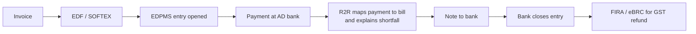

# India module

Why Indian exporters need help after a foreign payment arrives, and what our India module does. This is not legal or tax advice; check with your bank and accountant.

## In plain words

When an Indian business sells abroad, India's central bank (the Reserve Bank of India, or RBI) wants proof the money came home. The business declares each export to its bank. The bank opens an entry in RBI's tracking system. The entry stays open until the bank is satisfied that the full amount arrived. If the payment is short, or the bank cannot tell which bill it pays, the entry stays open. Open entries cost fees, block tax refunds and, if left long enough, limit future exports. Our module matches each payment to its export record, explains any gap and drafts the bank's note. The bank decides.

**Worked example.** We invoice a US customer $1,000 for design work. We declare it to our bank, which opens an entry for $1,000. The customer pays $1,000, but a bank on the way takes $20, so $980 arrives. The entry stays open because $980 is not $1,000. The module links the $980 to our invoice, reads the $20 deduction from the payment details, labels it "foreign bank charge" and drafts a request to close the entry at $980. We sign and send it.

## The rules that matter now

Terms:

- **AD bank** (Authorised Dealer): an Indian bank licensed by RBI to handle foreign money. It receives export payments and keeps export records.
- **EDF** (Export Declaration Form): your declaration of what you exported and its full value.
- **SOFTEX**: the older declaration form for software exports, certified by STPI, the Software Technology Parks of India ([RBI Master Direction, B.5](https://www.rbi.org.in/Scripts/BS_ViewMasDirections.aspx?id=10395); [Regulation 2](https://www.rbi.org.in/Scripts/BS_FemaNotifications.aspx?Id=13277)).
- **EDPMS** (Export Data Processing and Monitoring System): RBI's system where banks track every export until it is paid.
- **IRM** (Inward Remittance Message): the bank's record of one incoming foreign payment, which gets mapped to export bills ([r/IndiaTax example, 29 Aug 2026](https://reddit.com/r/IndiaTax/comments/1w1cvw0/gst_refund_filing_advice_needed/)).
- **FIRA / e-FIRC** (Foreign Inward Remittance Advice / electronic Certificate): a bank's proof that foreign money came in. **eBRC** (electronic Bank Realisation Certificate): proof that an export was paid, which banks must generate "only from the data available in EDPMS" ([RBI Master Direction, C.30](https://www.rbi.org.in/Scripts/BS_ViewMasDirections.aspx?id=10395)).
- **GST refund**: exports carry no GST (India's sales tax), so exporters can claim back GST paid on their costs. **Drawback**: a customs refund of duties paid on inputs to exported goods.

The rules:

1. **New regulations.** The Foreign Exchange Management (Export and Import of Goods and Services) Regulations, 2026 (Notification FEMA 23(R)/2026-RB, 13 Jan 2026) "shall come into force from October 01, 2026" ([RBI, amended up to 22 Sep 2026](https://www.rbi.org.in/Scripts/BS_FemaNotifications.aspx?Id=13277)). RBI's older Master Direction on exports (updated 17 Jul 2026) still governs transactions from before that date ([RBI Master Direction](https://www.rbi.org.in/Scripts/BS_ViewMasDirections.aspx?id=10395); [Regulation 20](https://www.rbi.org.in/Scripts/BS_FemaNotifications.aspx?Id=13277)).
2. **Nine months to get paid.** Money must arrive within "nine months" of shipment (goods) or invoice date (services), or twelve months if invoiced or settled in rupees. An amendment dated 22 Sep 2026 replaced "fifteen months" and "eighteen months", so older articles quoting 15 months are out of date. The bank may extend ([Regulation 5](https://www.rbi.org.in/Scripts/BS_FemaNotifications.aspx?Id=13277)).
3. **EDF for services.** File it "within 30 days from the end of month in which invoice for services has been raised". One EDF can cover a whole month. For goods through electronic ports, the shipping bill counts as the EDF ([Regulation 3](https://www.rbi.org.in/Scripts/BS_FemaNotifications.aspx?Id=13277)). Software counts as a service ([Regulation 2](https://www.rbi.org.in/Scripts/BS_FemaNotifications.aspx?Id=13277)).
4. **The ₹10 lakh route.** For a bill or invoice up to ₹10 lakh (1 lakh = 100,000), the entry "may be closed based on a declaration from the exporter", including quarterly bulk closure. A reduced value may also be accepted on declaration ([Regulations 4 and 6](https://www.rbi.org.in/Scripts/BS_FemaNotifications.aspx?Id=13277)). This started with RBI's circular of 1 Oct 2025 ([RBI Circular No. 12](https://www.rbi.org.in/Scripts/NotificationUser.aspx?Id=12908)). "May" means the bank chooses. One practitioner warns the bank "is not barred from asking for more if something looks off" ([r/IndiaTax, 5 Oct 2026](https://www.reddit.com/r/IndiaTax/comments/1wxtw13/edf_for_freelancers_rbis_new_export_declaration/)).
5. **Limits on reductions.** Above ₹10 lakh, the bank must be "satisfied of the reasons cited" ([Regulation 6](https://www.rbi.org.in/Scripts/BS_FemaNotifications.aspx?Id=13277)). The Master Direction says a reduction should not "exceed 25 per cent of invoice value", with no ceiling for exporters of over three years with a good track record ([RBI Master Direction](https://www.rbi.org.in/Scripts/BS_ViewMasDirections.aspx?id=10395)). The 2026 regulations name no percentage and leave this to each bank's policy ([Regulation 19](https://www.rbi.org.in/Scripts/BS_FemaNotifications.aspx?Id=13277)). We have not confirmed whether 25% still applies to new exports.
6. **When entries stay open.** If money is unpaid for over a year past the due date, the exporter may export only "against receipt of full advance or an irrevocable Letter of Credit" ([Regulation 13](https://www.rbi.org.in/Scripts/BS_FemaNotifications.aspx?Id=13277)). Bank charges must be "reasonable and proportional" ([Regulation 19(3)](https://www.rbi.org.in/Scripts/BS_FemaNotifications.aspx?Id=13277)).

## What goes wrong in practice

1. **Fees per bill.** A goods exporter with 2,000 shipments said the bank was "charging 500+18% GST per invoice" to link payments ([r/CharteredAccountants, 10 Dec 2024](https://reddit.com/r/CharteredAccountants/comments/1haudd7/bank_is_denying_to_issue_irm_for_ebrc_shipments/)). Kotak's tariff lists "Reduction in the export realization 1000" rupees ([Kotak, 12 Oct 2026](https://www.kotak.bank.in/content/dam/Kotak/gsfcfiles/trade/trade-services-final-12thOCT-new.pdf)).
2. **Payment not mapped.** The commonest reason an entry stays open: "the money arrived, but the bank was never told which bill it settles". Short payments from "bank charges, or an agreed reduction" cannot be auto-matched ([Skydo, a payments vendor, 12 Oct 2026](https://www.skydo.com/blog/edpms-entry-not-closed)).
3. **Wise, PayPal or Skydo break the link.** These services often pay out in rupees locally, so the bank sees no foreign payment. "How can it close anything on the epdms when it doesn't have anything open?" ([r/IndiaTax, 7 Oct 2026](https://www.reddit.com/r/IndiaTax/comments/1wxtw13/edf_for_freelancers_rbis_new_export_declaration/ped5j8t/)).
4. **FIRC versus FIRA.** One exporter's refund was refused: "The Department is insisting for FIRC or e-BRC instead of FIRA" ([TaxTMI, 16 May 2025](https://www.taxtmi.com/forum/issue?id=120022)). Others say "Many GST officers accept FIRA" ([CAclubindia, 14 Aug 2025](https://www.caclubindia.com/forum/firc-vs-fira-which-is-needed-for-gst-export-of-services-601534.asp)).
5. **Numbers and names that differ.** "An accounting ERP may show an invoice as settled while EDPMS remains open" when the bank lacks the right reference ([TaxGuru, CA Sandeep Kanoi, 17 Oct 2026](https://taxguru.in/finance/rbi-edpms-rs-10-lakh-export-bill-closure-2026-declarations-realisation-gst-accounting.html)). On Upwork, "the remiiter name will be Payment Escrow Inc.", not the client ([r/IndiaTax, 6 Oct 2026](https://www.reddit.com/r/IndiaTax/comments/1wxtw13/edf_for_freelancers_rbis_new_export_declaration/pe6elvt/)).
6. **Every bank differs.** "RBI has left the finer details to the bank" ([r/IndiaTax, 14 Oct 2026](https://reddit.com/r/IndiaTax/comments/1x5q6tz/_/pgorrfy)).
7. **Drawback at risk.** Some customs offices sent exporters "show cause notices" to recover drawback when foreign banks deducted charges. CBIC said officers may accept a "bank's confirmation regarding foreign bank charges" ([CBIC Circular 33/2019-Customs, 19 Sep 2019, via TaxGuru](https://taxguru.in/custom-duty/clarification-duty-drawback-allowed-cases-short-realisation-export-proceeds-due-bank-charges-deducted-foreign-banks.html)).

## What the module does

Rules in code make every match and number. A language model only reads messy text, such as payment narrations.

| Step | What it does | What a person approves |
|---|---|---|
| 1. Load | Reads the AD bank's statement and its list of open EDPMS entries | Which bank files to load |
| 2. Match | Links each payment to invoice, EDF or shipping bill, using amount, date, payer and reference | Any match below full confidence |
| 3. Explain | Splits each gap into bank charges, fees, discounts or currency difference, with evidence | The reason for each gap |
| 4. Route | Picks the ₹10 lakh declaration route or a reasoned request, per entry | The route |
| 5. Draft | Writes the closure letter or quarterly declaration | Signing and sending it |
| 6. Track | Watches the nine-month clock and flags entries near their deadline | Asking the bank for an extension |
| 7. Pack | Bundles invoice, payment, FIRA and eBRC per invoice for GST refunds | Filing the refund |

## What it does not do

- It does not file EDFs, declarations or GST refunds.
- It gives no legal or tax advice.
- It does not decide for the bank. The bank closes entries, accepts reductions and issues certificates.

## Limits and open questions

- **The rules are three weeks old.** RBI's deputy governor said RBI "would clarify the matter shortly through an FAQ" ([Mint, 7 Oct 2026](https://www.livemint.com/news/india/rbi-to-clarify-forex-reporting-rules-soon/amp-11791369703116.html)). We have not seen it.
- **Bank practice differs.** Each bank must publish its own policy ([Regulation 19](https://www.rbi.org.in/Scripts/BS_FemaNotifications.aspx?Id=13277)). Letters and formats will need per-bank templates.
- **No rupee account on Airwallex.** India is not among the receiving regions in Airwallex's Global Accounts table ([Airwallex coverage](https://www.airwallex.com/docs/global-treasury/market-and-infrastructure-coverage.md)). Airwallex's eligibility list maps India-registered businesses to its Singapore entity ([Airwallex Help: Eligible countries and territories](https://help.airwallex.com/hc/en-gb/articles/4408591334937)). One freelancer paid via Airwallex must still "manually mail Yes Bank(AD) to provide FIRA" for each payment ([r/IndiaTax, 4 Oct 2026](https://reddit.com/r/IndiaTax/comments/1wx772c/wise_business_payout_efirc_is_from_citi_inr_hits/pduc0sq/)). So the module works from the Indian bank's files, not from Airwallex.

## Evidence

The sources behind this page are in [`../research/data/pain-map-items.csv`](../research/data/pain-map-items.csv): 48 rows with lane_name "Indian exporters, freelancers and CAs", each with a verbatim quote, link, date and check result. [`../research/data/evidence-test-ledger.csv`](../research/data/evidence-test-ledger.csv) holds 47 rows with claim_id R8, from regulators, courts, practitioners and forums. Rows marked "partly" or "unchecked" carry caveats in check_note.
